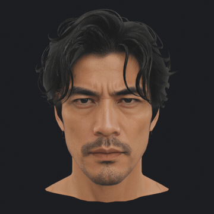
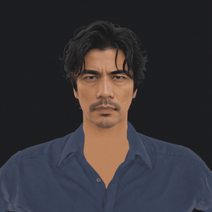
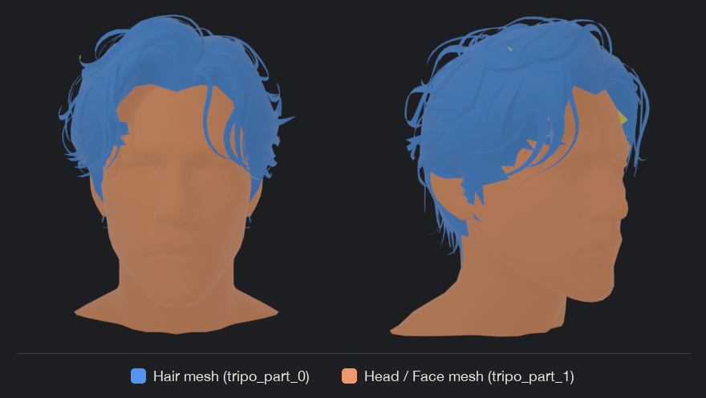

[日本語](README.md)

> [!NOTE]
> This entire project was built with Vibe Coding; I have not reviewed the internals, and the setup steps were written by AI and have not been verified by hand.
> If you use this project, please review it with your own AI assistant before running it.

# head2vrm: Create a VRM Avatar from a 3D Head Model

A tool that turns a 3D head model (GLB) into a VRM 1.0 avatar with working blinks, lip-sync, and facial expressions. The face keeps the appearance of your input model, while the body and clothing use the bundled base body.

| Input (3D Head Model / GLB) | Output (Generated VRM Avatar) |
| :---: | :---: |
|  |  |

- Supports blinking, eye gaze (`lookAt`), Japanese vowel lip-sync (`aa`, `ih`, `ou`, `ee`, `oh`), and standard VRM expressions (`happy`, `angry`, `sad`, `surprised`).
- Also supports all 52 iPhone face-tracking (ARKit) blendshapes.
- If hair is present, it is grafted onto the head with spring bones so it sways.
- Takes a few minutes per character on an Apple Silicon Mac. The pipeline pauses twice so you can visually verify contour lines.

## Requirements

| Requirement | Tested Version | How to Prepare |
|---|---|---|
| macOS | 26 | — |
| Blender | 5.2 LTS | Download from https://www.blender.org/download/ and place in `/Applications` |
| MPFB (Blender Extension) | 2.x | Enable MPFB in Blender under **Edit > Preferences > Get Extensions**, then install **MakeHuman system assets** via MPFB's **Load pack** |
| VRM format (Blender Extension) | 3.x | Enable **VRM format** in the same **Extensions** menu |
| Python | 3.12 | Install beforehand (`./setup.sh` creates the virtual environment and installs required packages) |

After cloning the repository, run the setup script once. It installs Python packages, downloads the pretrained model (MediaPipe Face Landmarker, ~3.6 MB), and runs an environment check. If anything is missing, it prints instructions on how to fix it.

```bash
git clone https://github.com/uemegu/head2vrm.git
cd head2vrm
./setup.sh
```

> If Blender, MPFB data, or Python 3.12 are installed in non-default locations, specify them via the `BLENDER`, `MPFB_DATA`, and `PYTHON` environment variables (for example: `PYTHON=/opt/homebrew/bin/python3.12 ./setup.sh`).

## What to Prepare (Input GLB Prerequisites)

Your input 3D head model (GLB) must meet the following prerequisites:

- **Pose & expression**: The head should face forward with the mouth closed and eyes open, and be recognizable as a human face. Because the pipeline automatically detects eye, mouth, and nose landmarks using MediaPipe, models that cannot be detected as a human face will not pass.
- **Mesh separation (head vs. hair)**: If your model has hair, **the head (face) and hair must be separated into distinct meshes/objects** in the GLB (for example, from Tripo's part-split export or separated in Blender).
  - Among parts with 300+ vertices, the tool automatically identifies **one head mesh** and **one hair mesh** based on skin-color ratio and height (if auto-detection misses, you can specify part indices via `HEAD_PART` / `HAIR_PART`).
  - Providing two GLBs exported from the same model—one **with hair** and one **without hair (face only)**—gives cleaner results around the forehead and hairline (a single GLB with head and hair as separate meshes also works).
  - If there is no hair, a single head GLB is enough.
- **Naming & texture constraints**:
  - Each mesh name in the GLB must end with an integer suffix such as `_0`, `_1` (e.g., `tripo_part_0`, `tripo_part_1`).
  - The head mesh must have UVs and a texture image on its first material, with dimensions **4096×4096 or smaller**.
- The final look is largely determined by your input head model, so it is worth checking that you are happy with the original face before starting.



## Usage

1. Create a working directory and copy `face.env.example` as `face.env`.

   ```bash
   mkdir -p work/myface
   cp face.env.example work/myface/face.env
   ```

2. Set the output name and GLB path(s) in `work/myface/face.env`.

   ```bash
   NAME=myface
   HEAD_GLB=/path/to/head.glb        # Head without hair (or the only GLB if no hair / combined in one GLB)
   HAIR_GLB=/path/to/head_hair.glb   # Head with hair (only needed when supplied separately from HEAD_GLB)
   BASE=base_asian                   # Body base: base_asian (female) or base_male (male)
   ```

3. Run the pipeline.

   ```bash
   ./make_face.sh work/myface
   ```

4. **Pause 1 — Eyelid contour check.** Open `work/myface/out/lidfit/check.jpg` and `check_corners.jpg` to confirm the orange lines sit on the eye margins. If they look good, run the approval command printed on screen and re-run the command from step 3. If they are misaligned, see "Adjusting misaligned lines" below.
5. **Pause 2 — Mouth contour check.** Open `work/myface/out/mouthfit/check.jpg` and confirm the lines follow the lip outline and seam. If they look good, run the printed approval command and re-run step 3.
6. Your avatar is exported to `work/myface/myface.vrm`.

### Adjusting Misaligned Lines

- **Upper eyelid line is too low overall**: Add `UP_RAISE=4` (pixels to raise the center) to `face.env`.
- **Only the inner or outer eye corners are off**: Create `corner_adjust.txt` in your working directory with one entry per line in the format `EYE CORNER DX DY`. `EYE` is `0` (screen-left eye) or `1`, `CORNER` is `inner` or `outer`, and `DX` / `DY` are in pre-upscale image pixels (negative moves left / up; note that `check.jpg` is upscaled 2x and `check_corners.jpg` is upscaled 6x). Example: `0 inner -6 -13`. To remove a previous adjustment, also delete `work/myface/out/lidfit/corner_adjust.txt`.
- **Mouth lines are far off**: Manual coordinate files are not supported for the mouth; check that the input model faces forward with its mouth closed.

After editing settings, re-run `./make_face.sh work/myface` to generate new check images and approve them.

## Viewing the Result

You can inspect the generated VRM with the bundled viewer (requires an internet connection because `three.js` and `@pixiv/three-vrm` are loaded from a CDN).

```bash
python3 -m http.server 5203 --bind 127.0.0.1
```

Open `http://localhost:5203/viewer/?model=../work/myface/myface.vrm` in your browser. You can also drag and drop a VRM file onto the page. Use the expression sliders to test blinking and lip-sync. By default, textures are shown unlit to match the input model's colors; toggle **"光を当てる" (Lit)** in the panel to switch to lit rendering.

When opened via the `?model=...` URL parameter, the viewer also applies a closed-eyelid texture patch (`myface-closedlid.png` and `.json` saved next to the VRM) for cleaner closed eyelids. This patch is not used on drag-and-drop or in external apps, though the VRM itself works standalone.

## Additional Settings (`face.env`)

| Name | Default | Description |
|---|---|---|
| `BASE` | `base_asian` | Base body: `base_asian` (female) or `base_male` (male) |
| `HEAD_ONLY` | *(unset)* | Any non-empty value (e.g., `1`) removes the body and clothes to export a head-only VRM (omit the line to disable) |
| `UP_RAISE` | `0` | Pixels to raise the center of the upper eyelid contour |
| `HAIR_SPRING` | `12` | Number of spring bone chains for hair physics (`0` disables swaying) |
| `LIPS` | `paint` | Set to `keep` to preserve the input model's original lip colors |
| `CORNEA` | `1` | Set to `0` to disable the glossy transmissive cornea material |
| `VRM_AUTHOR` | `unknown` | Author name written into the VRM metadata |

## Known Issues

- On `"aa"` and `"oh"` mouth shapes, the tongue may appear to protrude slightly.
- The VRM is saved in a T-pose with arms raised horizontally, which can make the shoulders bulge next to the neck (the bundled viewer lowers the arms for display).
- Skin tone may differ slightly between the face and body at the neck seam.
- Eyelid skin may appear slightly faceted when the eyes are closed.
- The glossy eye surface uses the glTF transmission extension (`KHR_materials_transmission`). In apps that do not support it, the eyes may look whitish; set `CORNEA=0` in `face.env` and re-export if this happens.
- Only the single mesh detected as hair is grafted. Multiple hair parts or accessories such as hairpins are not transferred (blonde, white, or skin-toned hair may also be missed by automatic detection).
- Tested on macOS only.

## License

- The scripts in this repository are licensed under the [MIT License](LICENSE).
- The bundled base body data (`tools/mpfb/base_asian/` and `tools/mpfb/base_male/`) is derived from MakeHuman system assets (CC0).

The following software and models are not bundled in this repository and are subject to their respective licenses:

- MPFB (GPL-3.0) and MakeHuman system assets (CC0): installed separately in Blender.
- MediaPipe Face Landmarker (Apache-2.0): downloaded by `setup.sh`.
- VRM format add-on, three.js, and three-vrm (all MIT).

Please follow the license and terms of your original 3D model when using it and distributing any VRM avatars generated from it.
