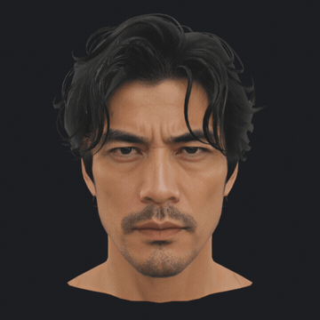
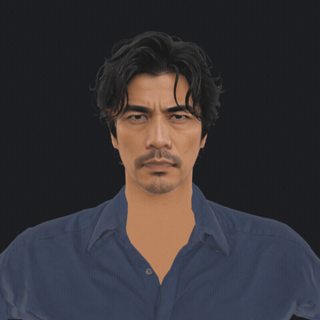
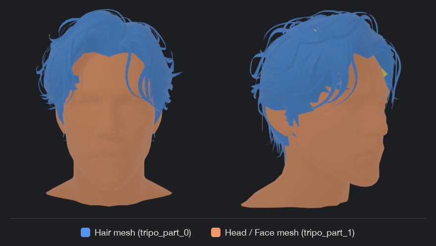

[English](README.en.md)

このプロジェクトはすべてVibe Codingで作っているので中身は見ていません。セットアップもAIが書いたもので確かめていません。
ご利用される場合はご自身で利用されているAIで確認してご利用ください。


# head2vrm：顔の 3D モデルから VRM アバターを作る

頭の 3D モデル（GLB）から、まばたき・口・表情が動く VRM 1.0 のアバターを作るツールです。顔の見た目は元のモデルのまま、体と服は付属の素体のものになります。

| インプット（頭の 3D モデル / GLB） | アウトプット（生成された VRM アバター） |
| :---: | :---: |
|  |  |

- まばたき、視線、あいうえおの口、VRM の標準の表情（笑顔・怒り・悲しみ・驚き）が動きます。
- iPhone の顔トラッキング（ARKit）の 52 個の表情にも対応しています。
- 髪があれば頭に載せて、揺れるようにします。
- 1 人あたり数分です（Apple Silicon の Mac）。途中で 2 回、線の確認のために止まります。

## 動作環境・必要なもの

| 必要なもの | 動作確認済みの版 | 準備方法 |
|---|---|---|
| macOS | 26 | — |
| Blender | 5.2 LTS | https://www.blender.org/download/ から `/Applications` へ配置 |
| MPFB（Blender 拡張機能） | 2.x | Blender の「編集 > プリファレンス > 機能拡張」で MPFB を有効にし、MPFB の「Load pack」から **MakeHuman system assets** を導入 |
| VRM format（Blender 拡張機能） | 3.x | 同じく「機能拡張」で VRM format を有効化 |
| Python | 3.12 | 事前にインストール（仮想環境と必要なパッケージは `./setup.sh` が用意） |

リポジトリを取得したあと、最初に一度だけセットアップを実行します。必要なパッケージと学習済みモデル（MediaPipe Face Landmarker、約 3.6MB）を取得し、環境チェックを行います。足りないものがあれば直し方が表示されます。

```bash
git clone https://github.com/uemegu/head2vrm.git
cd head2vrm
./setup.sh
```

> Blender・MPFB の素材・Python 3.12 を標準と異なる場所に置いている場合は、環境変数 `BLENDER`・`MPFB_DATA`・`PYTHON` で指定できます（例：`PYTHON=/opt/homebrew/bin/python3.12 ./setup.sh`）。

## 用意するもの（入力 GLB の前提条件）

頭の 3D モデル（GLB）は以下の条件を満たしている必要があります。

- **顔の向きと表情**：正面を向き、口を閉じ、目を開けた、人の顔として認識できるモデルにしてください。途中で顔の画像から MediaPipe で目・口・鼻の位置を自動検出するため、人の顔として検出できないモデルは処理できません。
- **パーツ構成（髪と顔の分離）**：髪がある場合は、**顔（頭）と髪が別メッシュ（別オブジェクト）に分かれている GLB** が前提です（Tripo のパーツ分割出力や Blender での分離など）。
  - ツール側では 300 頂点以上のパーツを対象に、テクスチャの肌色の割合と高さから **顔（1 部品）** と **髪（1 部品）** を自動で判別します（自動判定で外れる場合は `HEAD_PART` / `HAIR_PART` 環境変数で番号指定できます）。
  - 同じモデルから書き出した **髪つきの頭** と **髪を外して顔だけにした頭** の 2 つを用意すると、髪に隠れた額や生え際まできれいに仕上がります（1 つの GLB 内に顔と髪が別メッシュで入っている場合でも動作します）。
  - 髪がない場合は、頭の GLB 1 つで作れます。
- **メッシュ名・テクスチャの技術条件**：
  - GLB 内の各メッシュ名の末尾が `_0`, `_1` のような整数になっている必要があります（例：`tripo_part_0`, `tripo_part_1`）。
  - 顔のメッシュには UV と先頭マテリアルのテクスチャ画像が貼られており、画像サイズが **4096×4096 以下** である必要があります。
- 仕上がりの印象は元のモデルの顔でほぼ決まります。作り始める前に、元のモデルの顔を確認しておくことをおすすめします。



## 作り方

1. 作業フォルダを作り、`face.env.example` を `face.env` としてコピーします。

   ```bash
   mkdir -p work/myface
   cp face.env.example work/myface/face.env
   ```

2. `work/myface/face.env` に、名前と GLB のパスを書きます。

   ```bash
   NAME=myface
   HEAD_GLB=/path/to/head.glb        # 髪なしの頭（髪がない、または 1 つの GLB にまとまっている場合はその頭）
   HAIR_GLB=/path/to/head_hair.glb   # 髪つきの頭（HEAD_GLB と別に用意したときだけ書く）
   BASE=base_asian                   # 体：base_asian（女性）か base_male（男性）
   ```

3. 実行します。

   ```bash
   ./make_face.sh work/myface
   ```

4. **まぶたの線の確認で止まります。** `work/myface/out/lidfit/check.jpg` と `check_corners.jpg` を開き、オレンジの線が目の縁に乗っているかを確認します。問題なければ、画面に表示された承認コマンドを実行し、手順 3 のコマンドをもう一度実行します。ずれているときは、下の「線がずれているとき」を参照してください。
5. **口の線の確認で止まります。** `work/myface/out/mouthfit/check.jpg` を見て、線が唇の縁と合わせ目に乗っていれば、同じように画面に表示されたコマンドで承認し、もう一度実行します。
6. `work/myface/myface.vrm` ができあがります。

### 線がずれているとき

- **上まぶたの線が全体に低いとき**：`face.env` に `UP_RAISE=4` のように書きます（中央を何 px 上げるか）。
- **目頭や目尻だけがずれているとき**：作業フォルダに `corner_adjust.txt` を作り、1 行に `目 角 横 縦` を書きます。目は `0`（画面の左の目）か `1`、角は `inner`（目頭）か `outer`（目尻）、横と縦は拡大前の画像座標の px です（左と上へはマイナス。`check.jpg` は 2 倍、`check_corners.jpg` は 6 倍に拡大されています）。例：`0 inner -6 -13`。なお、補正をやめるときは `work/myface/out/lidfit/corner_adjust.txt` も削除してください。
- **口の線が大きくずれているとき**：口は手動の座標ファイルには対応していないため、元のモデルが正面を向いて口を閉じているかを見直してください。

設定を直したらもう一度 `./make_face.sh work/myface` を実行します。新しい確認画像が出るので、再度確認して承認します。

## できたものを見る

付属のビューアで確認できます（three.js / three-vrm を CDN から読み込むため、インターネット接続が必要です）。

```bash
python3 -m http.server 5203 --bind 127.0.0.1
```

ブラウザで `http://localhost:5203/viewer/?model=../work/myface/myface.vrm` を開きます。VRM ファイルを画面へドラッグ＆ドロップして開くこともできます。表情のスライダーを動かして、まばたきや口を確かめられます。既定では元のモデルのテクスチャ色をそのまま表示し、パネルの「光を当てる」で照明ありの表示に切り替えられます。

URL（`?model=...`）で開いた場合、このビューアは目を閉じたときのまぶたをきれいに見せる補正を使います（VRM と同じフォルダに出力される `myface-closedlid.png` と `.json`）。ドラッグ＆ドロップで開いた場合やほかのアプリではこの補正は使われませんが、VRM 単体でそのまま利用できます。

## そのほかの設定（face.env）

| 名前 | 既定 | 意味 |
|---|---|---|
| `BASE` | `base_asian` | 素体：`base_asian`（女性）か `base_male`（男性） |
| `HEAD_ONLY` | なし | 空でない値（例：`1`）を指定すると、体と服を外して首から上だけの VRM にする（無効にする場合は行を書かない） |
| `UP_RAISE` | `0` | 上まぶたの線を中央で何 px 上げるか |
| `HAIR_SPRING` | `12` | 髪の揺れる骨（スプリングボーン）の本数。`0` で揺らさない |
| `LIPS` | `paint` | `keep` にすると、唇を元のモデルの色のままにする |
| `CORNEA` | `1` | `0` にすると、目の表面の透過つやを無効にする |
| `VRM_AUTHOR` | `unknown` | VRM に書き込む作者名 |

## 既知の問題

- 「あ」「お」の口で、舌が前に出て見えることがあります。
- VRM は腕を水平に上げた T ポーズで保存されます。腕を上げたままだと、首の横の肩が盛り上がって見えます（付属のビューアは腕を下ろして表示します）。
- 首の継ぎ目で、顔と体の肌の色が少し違うことがあります。
- 目を閉じたとき、まぶたの肌が少し角ばって見えることがあります。
- 目の表面のつやに glTF の透過拡張（`KHR_materials_transmission`）を使っています。対応していないアプリでは目が白っぽく見えることがあるため、その場合は `face.env` に `CORNEA=0` と書いて作り直してください。
- 髪は、髪として認識された 1 つの部品だけをそのまま載せます。複数の髪部品や髪留めなど、ほかの部品は載りません（金髪・白髪など肌色に近い髪は自動判定から外れることがあります）。
- macOS でしか動作確認していません。

## ライセンス

- このリポジトリのスクリプトは [MIT License](LICENSE) です。
- 同梱している素体データ（`tools/mpfb/base_asian/`・`tools/mpfb/base_male/`）は、MakeHuman system assets（CC0）から作成したものです。

次のソフトウェア・モデルはリポジトリに同梱しておらず、それぞれのライセンスに従います。

- MPFB（GPL-3.0）および MakeHuman system assets（CC0）：Blender に各自で導入します。
- MediaPipe Face Landmarker（Apache-2.0）：`setup.sh` が取得します。
- VRM format アドオン、three.js、three-vrm（いずれも MIT）。

元の 3D モデルおよびそこから生成した VRM の扱いは、元のモデルの利用条件に従ってください。
